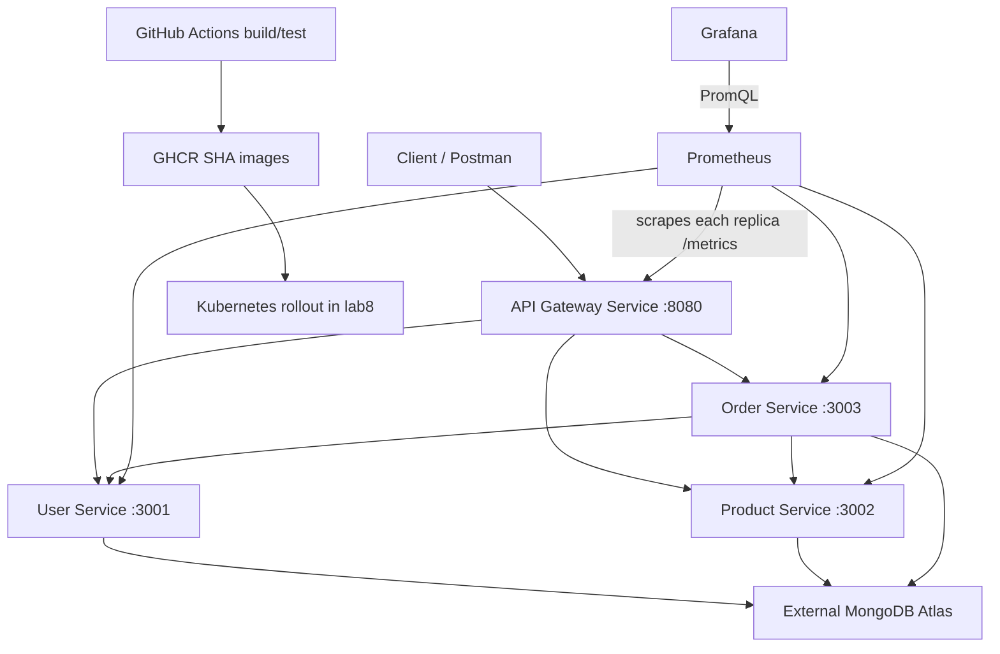

# Lab 8: Kubernetes, CI/CD and monitoring

Extends the original CampusConnect Lab 7 source from https://github.com/hitarth3/webandsoa. Original documentation: [Lab 7](docs/LAB7.md). The four existing Express services and MongoDB Atlas application remain in use.

## Implementation status
Source implementation is prepared. Live Docker builds, Kubernetes deployment, Atlas access, GitHub Actions execution, registry delivery, and monitoring screenshots have NOT been verified in this environment. Docker was stopped, kubectl had no context, and shell network access failed. Do not present this package as completed runtime evidence.

## Local Kubernetes deployment
Use Docker Desktop with Kubernetes enabled. Required: Docker, kubectl, Node 22, MongoDB Atlas. Select your intended lab context (for Docker Desktop: `kubectl config use-context docker-desktop`) then:

```sh
kubectl config current-context
kubectl get nodes
bash scripts/build.sh
kubectl apply -f k8s/namespace.yaml
```

Create an ignored file `atlas.env` with three keys: `user-service`, `product-service`, `order-service`. Each value is the corresponding Atlas connection URI, with databases campus_users, campus_products and campus_orders respectively. Allow the cluster's actual outbound IP in Atlas. Never commit this file.

```sh
kubectl create secret generic atlas -n lab8 --from-env-file=atlas.env
kubectl apply -f k8s/
kubectl get deployments,pods,services -n lab8
kubectl rollout status deployment/user-service -n lab8 --timeout=240s
kubectl port-forward -n lab8 service/api-gateway 8080:8080
```

Local images must be available to the cluster's runtime. For kind use `kind load docker-image api-gateway:lab8 user-service:lab8 product-service:lab8 order-service:lab8`. For another cluster push images to a registry and update Deployment image references first.

Gateway: http://localhost:8080. Import the existing Lab 7 Postman collection, set baseUrl to this address, and test GET /users, GET /products, POST /orders and GET /orders. Capture actual responses. Seed user 101 and product 501 are available on an empty database; otherwise use actual IDs from list responses.

```sh
curl -f http://localhost:8080/health
curl -f http://localhost:8080/users
curl -f http://localhost:8080/products
curl -f -H 'Content-Type: application/json' -d '{"userId":101,"productId":501,"quantity":1}' http://localhost:8080/orders
```

Only gateway traffic is forwarded externally; all Services are ClusterIP. Service DNS names are in ConfigMap lab8-config. Sensitive URIs are in Secret atlas. Liveness uses /health; backend readiness uses /ready and returns 503 when MongoDB is disconnected. Startup probes allow 200 seconds for database connection. Gateway health checks its own process; downstream failures remain visible as proxy errors.

## Scaling, self-healing and troubleshooting

```sh
kubectl scale deployment user-service --replicas=3 -n lab8
kubectl rollout status deployment/user-service -n lab8
kubectl get pods -n lab8 -l app=user-service -o wide
# Record one pod name from the previous command, then replace POD below.
kubectl delete pod POD -n lab8
kubectl get pods -n lab8 -l app=user-service -w
kubectl describe deployment user-service -n lab8
kubectl logs deployment/user-service -n lab8
kubectl get endpoints -n lab8
```

Capture the old pod name and replacement with a new UID reaching Ready. Service DNS stays stable while replicas change. For Pending pods inspect resource limits; for ImagePullBackOff check registry visibility, image tag and pull credentials; for failed readiness check Atlas IP access and URI. Do not print secrets in evidence. Configuration updates require restarting Deployments because environment values are read on startup.

## CI/CD
.github/workflows/ci.yml runs on main pushes and pull requests. Each service installs its existing dependencies, runs metrics tests, builds its actual Docker context, and (on trusted pushes) publishes `ghcr.io/hitarth3/webandsoa/SERVICE:COMMIT_SHA`. Pull requests never publish or deploy. Existing dependency ranges are retained; three original services have no lockfiles, so installations are not yet fully reproducible. Generate and commit lockfiles with npm install, then use npm ci in CI and Dockerfiles for deterministic installs.

To enable CD configure GitHub environment lab8 with secret KUBE_CONFIG containing a kubeconfig for a cluster reachable by the hosted runner; create the Atlas Secret there first. Set repository variable DEPLOY_ENABLED=true. Local Docker Desktop is not reachable by hosted runners: keep CD disabled and apply the SHA images manually locally, or use a reachable lab cluster. GHCR packages must be readable by the cluster; configure an imagePullSecret for private packages. The deploy job renders SHA image references before applying, then waits for every rollout. A successful build alone is not deployment evidence. Push a small valid change again to demonstrate a second run.

## Prometheus and Grafana

Create grafana.env (ignored) with `password=YOUR_CHOSEN_PASSWORD`, then:

```sh
kubectl create secret generic grafana-admin -n lab8 --from-env-file=grafana.env
kubectl apply -f monitoring/ --recursive=false
kubectl rollout status deployment/prometheus -n lab8
kubectl rollout status deployment/grafana -n lab8
kubectl port-forward -n lab8 service/prometheus 9090:9090
# Separate terminal:
kubectl port-forward -n lab8 service/grafana 3000:3000
```

Use http://localhost:9090/targets and http://localhost:3000 (admin / chosen password). Grafana provisions Prometheus and the Lab 8 dashboard automatically. Headless Services let Prometheus discover each ready replica separately. /metrics exports request counters and duration sum/count with bounded service/method/route/status labels. Probes and scrapes are excluded from business traffic. Dashboard panels show availability, requests/s, 4xx/5xx errors/s and mean duration. Mean duration is not a latency percentile. Monitoring storage is ephemeral for this lab.

Useful queries: `up`, `sum by(service) (rate(http_requests_total[5m]))`, `sum by(service) (rate(http_requests_total{status=~"5.."}[5m]))`. Generate traffic with `bash scripts/traffic.sh`; it includes safe invalid numeric IDs (400). Wait for two or more scrapes before comparing rates. Capture a before/after dashboard and target UP state. Kubernetes workload health is checked with kubectl Ready/available replica counts; infrastructure exporters are not included.

## Architecture



## Evidence to collect before submission

- Lab 7 baseline gateway request and response.
- Current context and node output.
- Applied manifests and probe configuration.
- Deployments, Pods Ready and Services in lab8.
- At least two successful Postman gateway operations and order orchestration.
- User Service scaled to three replicas.
- Deleted pod and replacement reaching Ready.
- Describe/logs/endpoints troubleshooting output.
- Successful Actions runs, GHCR SHA tag, deployed image and rollout output.
- Prometheus targets UP and a useful query result.
- Grafana dashboard before/after traffic.
- Final architecture diagram above.

Store new evidence in evidence/lab8/ with descriptive filenames. Old Lab 7 screenshots are not Lab 8 evidence. Run `node --test tests/metrics.test.js` to verify the metrics logic without external dependencies.
